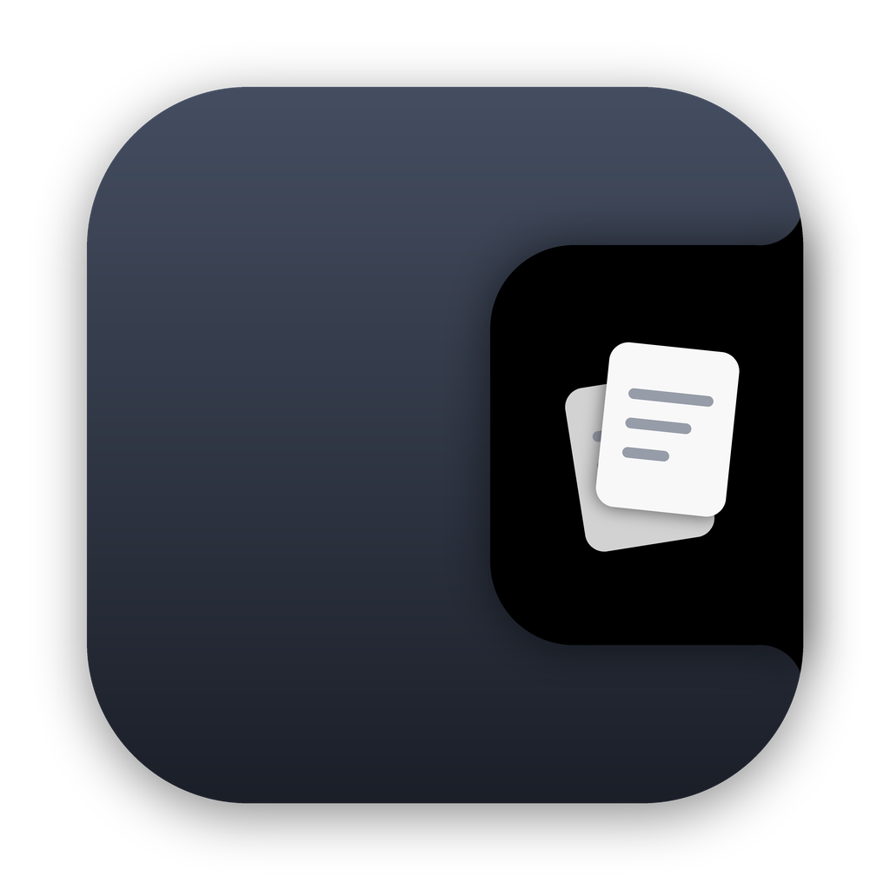
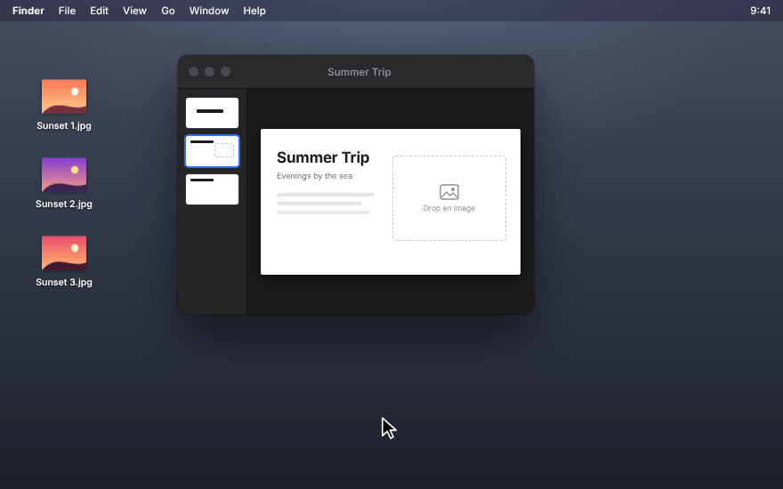
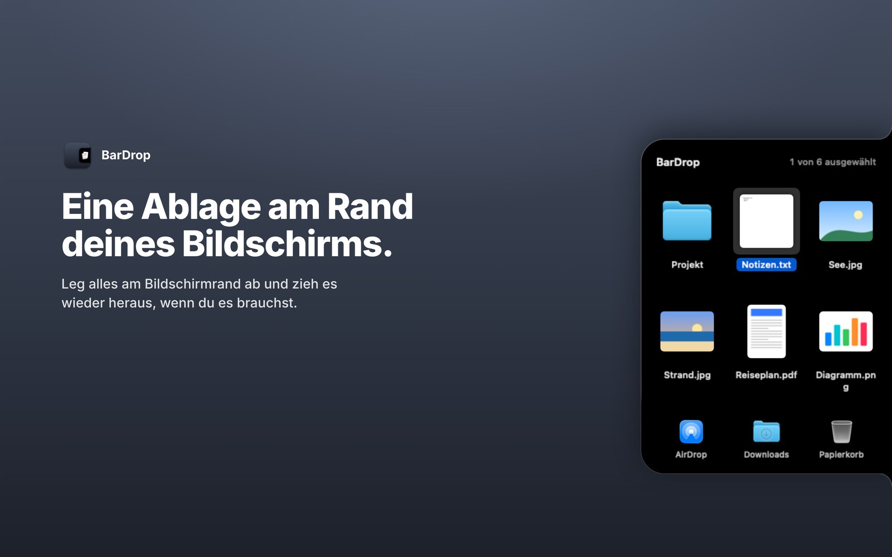
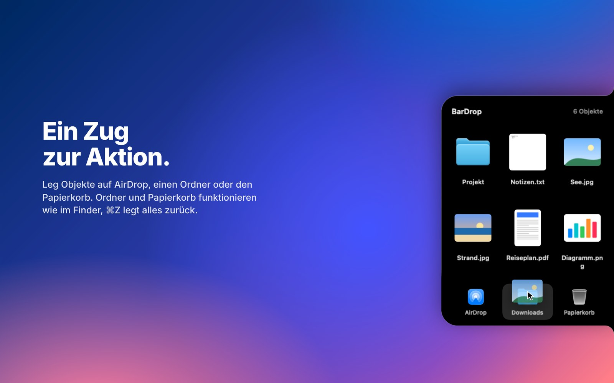
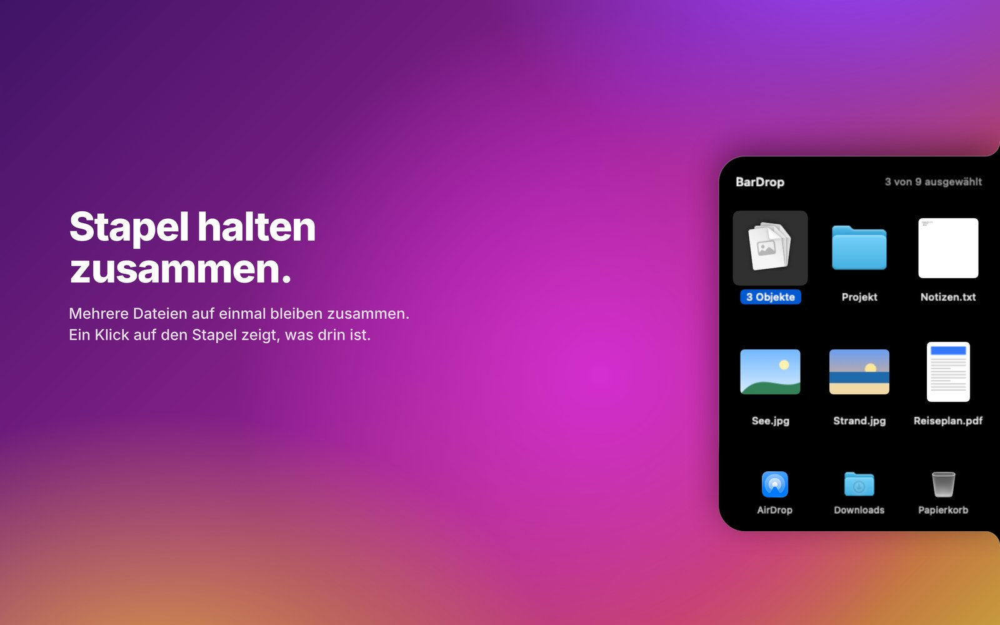
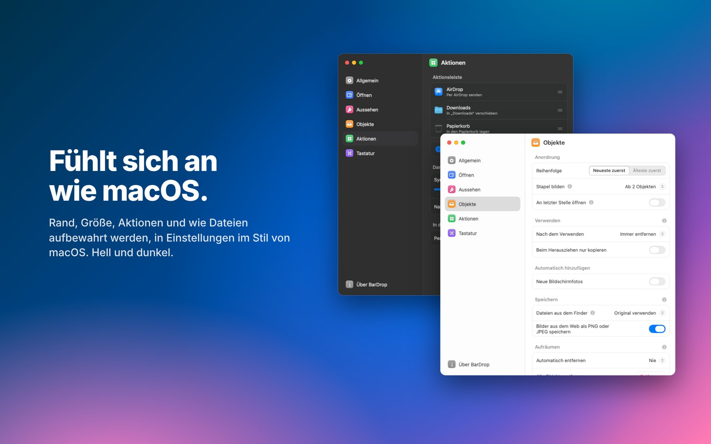

<p align="center">
  
</p>

<h1 align="center">BarDrop</h1>

<p align="center">
  Eine unsichtbare Ablage am Rand deines Bildschirms.<br>
  Zieh eine Datei hinein, hol sie später wieder heraus.
</p>

<p align="center">
  <a href="../README.md">English</a> · <b>Deutsch</b>
</p>

<p align="center">
  <a href="https://github.com/zzuuuiii/BarDrop/releases/latest/download/BarDrop.dmg"><b>Herunterladen</b></a>
  &nbsp;·&nbsp;
  <a href="https://github.com/zzuuuiii/BarDrop/releases">Alle Versionen</a>
  &nbsp;·&nbsp;
  <a href="../CHANGELOG.md">Änderungen (englisch)</a>
  &nbsp;·&nbsp;
  <a href="#bildschirmfotos">Bildschirmfotos</a>
</p>

<p align="center">
  <a href="https://github.com/zzuuuiii/BarDrop/releases/latest"></a>
  
  
  <a href="../LICENSE"></a>
</p>

<p align="center">
  
</p>

---

## So funktioniert es

1. **Datei ziehen.** Am Bildschirmrand wölbt sich ein flacher schwarzer Streifen heraus.
2. **Darüber halten.** Die Ablage öffnet sich mit einem leichten Impuls auf dem Trackpad. Loslassen, fertig.
3. **Später.** Zeiger an den Rand, die Ablage geht auf, Datei herausziehen und in jede App ablegen.

Bilder aus dem Browser, Links und Text funktionieren genauso wie Dateien. Beim ersten Start zeigt eine kurze Einführung jeden Schritt zum Mitmachen.

## Installation

1. [**BarDrop.dmg herunterladen**](https://github.com/zzuuuiii/BarDrop/releases/latest/download/BarDrop.dmg) und öffnen.
2. BarDrop im Fenster auf den Ordner **Programme** ziehen.
3. BarDrop aus „Programme“ starten.

> [!NOTE]
> **Warnung beim ersten Öffnen?** macOS meldet bei jeder App, die nicht über Apples kostenpflichtiges Entwicklerprogramm notarisiert ist, dass sie nicht geprüft werden kann. Das bedeutet nicht, dass etwas Schädliches gefunden wurde. Die DMG wird von [GitHub Actions](https://github.com/zzuuuiii/BarDrop/actions) direkt aus diesem Quellcode gebaut.
>
> Einmalig freigeben: Meldung schließen, dann **Systemeinstellungen → Datenschutz & Sicherheit → Trotzdem öffnen**.

Danach hält sich BarDrop im Hintergrund selbst aktuell, während du es nicht benutzt, jeweils zwei Tage nach dem Erscheinen einer Version. Das und frühe Beta-Versionen stellst du unter Einstellungen → Über BarDrop ein.

## Bildschirmfotos

<p align="center">
  
  
  
  
</p>

## Funktionen

**Ablage**
* Links oder rechts, feste Höhe oder dort, wo der Zeiger den Rand erreicht (ganzer Rand oder mittlere Hälfte)
* Öffnet sofort oder nach 1 bis 5 Sekunden am Rand, per Klick oder per Kurzbefehl; ein Klick auf den Streifen überspringt die Wartezeit
* Großzügiger Trefferbereich, du musst den Streifen nicht genau treffen, oder auf Wunsch ein kleiner, der nur auf den Streifen selbst reagiert
* Apps ausnehmen, in denen der Rand die Ablage nicht öffnen soll, zum Beispiel Spiele, und auf Wunsch im Vollbild geschlossen bleiben
* Auch schnell an den Rand geworfene Dateien werden sicher aufgenommen
* Feiner heller Rahmen, damit sie auch auf dunklem Hintergrund zu sehen ist
* Auf allen Bildschirmen oder nur auf dem integrierten bzw. den externen
* Verbraucht im Ruhezustand praktisch keine Energie

**Objekte**
* Dateien, Ordner, Bilder aus dem Web (WebP, AVIF und HEIC lassen sich als PNG oder JPEG speichern), Links und Text
* Neue Bildschirmfotos landen auf Wunsch automatisch in der Ablage
* Umwandeln per Rechtsklick: Bilder, PDF-Seiten, Textdokumente, Audio und Video, nur mit dem, was macOS mitbringt
* Neueste zuerst, Stapel, Auswahl wie im Finder
* Dateien aus dem Finder als Original oder als eigene Kopie
* Versehentlich entfernt oder in den Papierkorb gelegt? `⌘Z` holt es zurück
* Verschobene oder umbenannte Dateien bleiben in der Ablage, Dateien aus iCloud werden bei Bedarf geladen, Dateien von getrennten Laufwerken bleiben ausgegraut erhalten
* Inhalt bleibt nach einem Neustart erhalten, auf Wunsch nach 1 bis 24 Stunden automatisch aufgeräumt; auf Wunsch öffnet die Ablage an der letzten Stelle

**Aktionsleiste**
* AirDrop, Mail, Nachrichten, Teilen, Papierkorb, beliebige Ordner und Apps
* Objekte darauf ziehen
* Klick auf einen Ordner zeigt seinen Inhalt direkt in der Ablage, wie einen Stapel: auswählen, herausziehen, Übersicht und Papierkorb wie im Finder, Unterordner öffnen und Dateien hineinziehen, um sie in den Ordner zu legen; `esc` geht zurück
* Ordner und Papierkorb wie im Finder: auf derselben Platte verschiebt ein Ordner, auf einer anderen kopiert er (`⌥` kopiert immer, `⌘` verschiebt immer)
* Zwei Reihen mit je bis zu fünf Aktionen; Namen bei allen Aktionen, nur bei Ordnern oder keinen
* Der Papierkorb sieht voll oder leer aus wie der Papierkorb deines Mac
* Auf Wunsch Ordner und Apps per Ziehen auf die Ablage anheften und Aktionen durch Herausziehen entfernen

**Plugins** (optional, standardmäßig aus)
* Eigene Schritte als `.bdrop`-Dateien: im Rechtsklick-Menü, in der Aktionsleiste oder automatisch beim Ablegen passender Dateitypen und Links
* In JavaScript geschrieben, mit Rechten, die beim ersten Gebrauch erfragt werden; Ergebnisse erscheinen direkt neben dem Original
* BarDrop bringt selbst kein Plugin mit. So schreibst du eins: [PLUGINS.de.md](PLUGINS.de.md)

**Einstellungen**
* Kurze Einführung beim ersten Start: wo die Ablage ist, Ablegen, Aktionen, Kurzbefehl und Öffnen mit dem Zeiger
* Startet standardmäßig beim Anmelden
* Englisch oder Deutsch, standardmäßig wie die Sprache des Systems
* Kein Symbol in der Menüleiste: Rechtsklick in die Ablage für Einstellungen und Beenden

## Tastatur

| Taste | Aktion |
|---|---|
| `⌃⌥B` | Ablage überall ein- oder ausblenden (unter Einstellungen → Tastatur änderbar) |
| Leertaste, `⌘Y` | Übersicht (Quick Look) |
| `↩`, `⌘O` | Öffnen |
| `⌘R` | Im Finder zeigen |
| `⌘I` | Informationen (Fenster „Informationen“ des Finders) |
| `⌘A` | Alle auswählen |
| `⌘X` | Ausschneiden: in die Zwischenablage und aus der Ablage |
| `⌘C`, `⌥⌘C` | Kopieren, Pfad kopieren |
| `⌘V` | Aus der Zwischenablage einfügen |
| `⌫` | Auswahl aus der Ablage entfernen, danach ist das nächste Objekt ausgewählt |
| `⌘⌫` | Auswahl in den Papierkorb legen |
| `⌘Z`, `⇧⌘Z` | Widerrufen, wiederholen |
| `⌘↑` | Zurück aus einem Stapel |
| `⌘,` | Einstellungen |
| Pfeiltasten | Auswahl bewegen, mit `⇧` erweitern |
| `esc` | Auswahl aufheben, Stapel verlassen, dann schließen |

## Datenschutz

BarDrop sammelt keine Daten und sendet nichts über dich. Die Ablage liegt nur auf deinem Mac unter `~/Library/Application Support/BarDrop`. BarDrop verbindet sich nur mit GitHub: für die Suche nach Updates, die sich abschalten lässt, und für „Was ist neu“, wenn du Einstellungen → Über BarDrop öffnest. Bilder und Links aus dem Web werden nur dann geladen, wenn du sie selbst in die Ablage ziehst.

**Diagnoseprotokoll (nur Beta-Versionen, standardmäßig aus).** Wer Beta-Versionen nutzt, kann unter Einstellungen → Über BarDrop ein Diagnoseprotokoll einschalten, nach einem Hinweis, was es erfasst. Es hält ausführlich fest, was in der App passiert (Ablegen, Vorschaubilder, die Ablage am Rand, Aktionen, die Einführung, Fehler), dazu deine Einstellungen sowie Mac-Modell und macOS-Version. Datei- und Ordnernamen, Pfade und Inhalte werden nie erfasst; Dateien erscheinen nur als anonyme Kennung mit ihrem Typ. Das Protokoll bleibt auf deinem Mac unter `~/Library/Logs/BarDrop` und wird nirgendwohin geschickt. Erst „Protokoll sichern“ erstellt eine Textdatei, die du selbst weitergeben kannst, um bei der Fehlersuche zu helfen. Ausschalten löscht das Protokoll.

## Selbst bauen

```bash
git clone https://github.com/zzuuuiii/BarDrop.git
cd BarDrop
./scripts/build_app.sh        # erzeugt build/BarDrop.app und build/BarDrop.dmg
swift test                    # automatische Tests
```

BarDrop läuft ab macOS 14; zum Bauen braucht es Xcode 26 oder neuer. Jeder Push auf `main` baut die App, führt die Tests aus und veröffentlicht die DMG als Release der Version in [`VERSION`](../Resources/VERSION).

### Entwicklung

Die Ablage speichert ihren Inhalt in `shelf.json`. Damit ein Update nie Einträge verliert, gelten zwei Regeln:

* **Neue Felder** in `ShelfFile` oder `ShelfEntry` sind optional (`var feld: Typ?`) oder werden in einem eigenen `init(from:)` mit `decodeIfPresent(…) ?? Standardwert` gelesen. Ein Vorgabewert wie `= Date()` genügt nicht: Der vom Compiler erzeugte Decoder verlangt das Feld trotzdem, und alte Einträge wären unlesbar.
* **Pro Release eine Fixture:** `Tests/Fixtures/shelf-<Version>.json` ist eine `shelf.json` dieser Version. Darin steht `__ROOT__` statt des Benutzerordners, und die Ablage selbst liegt unter `__ROOT__/Support/BarDrop` (statt `~/Library/Application Support/BarDrop`). `FixtureTests` lädt alle Fixtures und schlägt fehl, sobald ein Eintrag unlesbar wird oder verloren geht.

<details>
<summary><b>Projektaufbau</b></summary>

| Datei | Aufgabe |
|---|---|
| `EdgeController.swift`, `EdgeLogic.swift` | Erkennen von Zeiger und Ziehen, Entscheidung über die Stufen |
| `ShelfPanel.swift`, `ShelfViews.swift`, `EdgeBlobShape.swift` | Fenster, Oberfläche und Form der Ablage |
| `ShelfStore.swift` | Inhalt, Speicherung, Widerrufen |
| `ContentImporter.swift`, `ImageNormalizer.swift`, `CloudFiles.swift`, `FileSanitizer.swift` | Dateien, Web-Bilder, Links und Text übernehmen |
| `DragExport.swift`, `DragSource.swift` | Herausziehen |
| `ShelfActions.swift`, `ActionBar.swift`, `QuickActions.swift` | Auswahl, Menüs, Aktionsleiste |
| `SettingsWindow.swift`, `SettingsView.swift`, `SettingsStyle.swift`, `AppSettings.swift` | Einstellungen |
| `L10n.swift` | Englische und deutsche Texte |
| `Onboarding.swift` | Einführung beim ersten Start |
| `Updater.swift`, `ReleaseNotes.swift` | Updates und Änderungen von GitHub |
| `Tests/` | Automatische Tests |
| `scripts/` | Bauen, DMG, App-Symbol, Vorschau |

</details>

## Danksagung

BarDrop wäre ohne diese Projekte nicht so, wie es ist:

* [**Alcove**](https://tryalcove.com): Vorbild für Form und Bewegung der schwarzen Ablage, die aus dem Bildschirmrand wächst.
* [**Klack**](https://tryklack.com): Vorbild für Aufbau und Gestaltung der Einstellungen.
* [**boring.notch**](https://github.com/TheBoredTeam/boring.notch): Teile des Codes, vor allem die Übernahme von Bildern aus dem Web.
* [**perch**](https://github.com/hausfold/perch): Teile des Codes, mit denen die App verbessert wurde, etwa beim Herausziehen und bei iCloud-Dateien.

Details zu Lizenzen fremden Codes stehen in [THIRD_PARTY_NOTICES.md](THIRD_PARTY_NOTICES.md). BarDrop ist ein eigenständiges Projekt und steht in keiner Verbindung zu diesen Projekten.

## Mitmachen

Fehler und Ideen gern über [Issues](https://github.com/zzuuuiii/BarDrop/issues/new/choose), Sicherheitslücken bitte vertraulich (siehe [SECURITY.md](../.github/SECURITY.md)). Wie Beiträge ablaufen, steht in [CONTRIBUTING.md](../.github/CONTRIBUTING.md).

## Lizenz

© 2026 zzuuuiii. BarDrop ist freie Software unter der [GNU General Public License v3.0](../LICENSE). Du darfst es nutzen, verändern und weitergeben, solange Weitergaben ebenfalls unter der GPL-3.0 stehen und den Quellcode mitliefern. BarDrop wird ohne Gewährleistung bereitgestellt.
